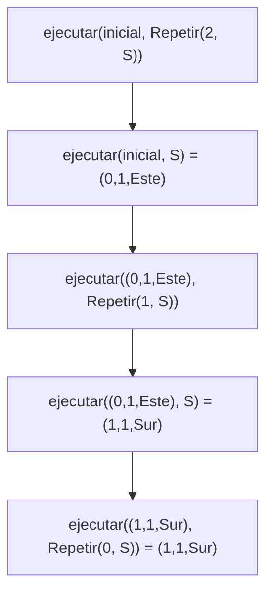
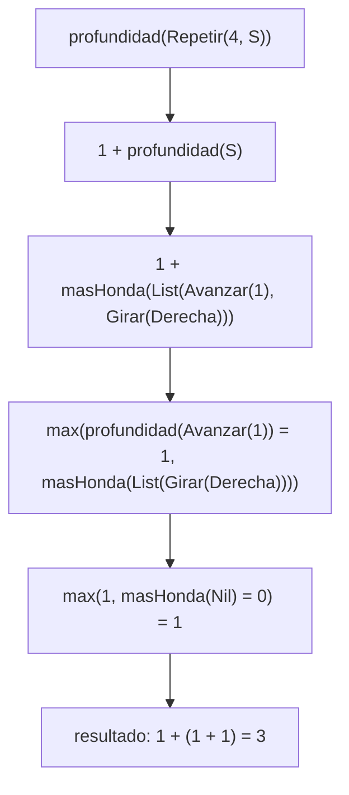

# Ejemplo de informe de corrección

Fundamentos de Programación Funcional y Concurrente.
Documento realizado por el docente Juan Francisco Díaz.

## 1. Argumentar la corrección de programas recursivos

Sea $f : A \to B$ una función, y $A$ un conjunto definido recursivamente
(recordar la definición de Matemáticas Discretas I), como por ejemplo los
naturales o las listas.

Sea $P_f$ un programa recursivo (lineal o en árbol) desarrollado en Scala (o en
cualquier lenguaje de programación) hecho para calcular $f$:

```scala
def Pf(a: A): B = { // Pf recibe a de tipo A, y devuelve f(a) de tipo B
  ...
}
```

¿Cómo argumentar que $P_f(a)$ siempre devuelve $f(a)$ como respuesta? Es decir,
¿cómo argumentar que $P_f$ es correcto con respecto a su especificación?

La respuesta es sencilla: demostrando el siguiente teorema.

```math
\forall a \in A : P_f(a) == f(a)
```

Cuando uno tiene que demostrar que algo se cumple para todos los elementos de
un conjunto definido recursivamente, es natural usar inducción estructural. En
términos prácticos, esto significa demostrar que:

- Para cada valor básico $a$ de $A$, se tiene que $P_f(a) == f(a)$.
- Para cada valor $a \in A$ construido recursivamente a partir de otro(s)
  valor(es) $a' \in A$, se tiene que
  $P_f(a') == f(a') \rightarrow P_f(a) == f(a)$. (Esta es la hipótesis de
  inducción).

### Ejemplo: factorial recursivo

Sea $f : \mathbb{N} \to \mathbb{N}$ la función que calcula el factorial de un
número natural, es decir, $f(n) = n!$. Y sea $P_f$ el siguiente programa en
Scala:

```scala
def Pf(n: Int): Int = { // Pf recibe n de tipo Int, y devuelve n! de tipo Int
  if (n == 0) 1 else n * Pf(n - 1)
}
```

Vamos a demostrar que $\forall n \in \mathbb{N} : P_f(n) == n!$

**Caso base:** $n = 0$

```math
P_f(0) \rightarrow \text{if } (0 == 0)\ 1 \text{ else } 0 \ast P_f(-1) \rightarrow 1
```

Por otro lado, $f(0) = 0! = 1$. Entonces $P_f(0) == f(0)$.

**Caso de inducción:** $n = k + 1$, $k \geq 0$. Hay que demostrar:
$P_f(k) == f(k) \rightarrow P_f(k + 1) == f(k + 1)$

```math
P_f(k+1) \rightarrow \text{if } (k+1 == 0)\ 1 \text{ else } (k+1) \ast P_f(k) \rightarrow (k+1) \ast P_f(k)
```

Usando la hipótesis de inducción (HI):

```math
\rightarrow (k+1) \ast k! = (k+1)!
```

Por lo tanto, $P_f(k + 1) == f(k + 1)$.

Concluimos por inducción que $\forall n \in \mathbb{N} : P_f(n) == n!$

### Ejemplo: el máximo de una lista

Sea $f : \text{List}[\mathbb{N}] \to \mathbb{N}$ la función que calcula el
máximo de una lista de enteros positivos, no vacía. Y sea $P_f$ el siguiente
programa en Scala:

```scala
def maxLin(l: List[Int]): Int = {
  if (l.tail.isEmpty) l.head
  else math.max(maxLin(l.tail), l.head)
}
```

Demostraremos que:

```math
\forall n \in \mathbb{N} \setminus \{0\} : P_f(\text{List}(a_1, a_2, \ldots, a_n)) == f(\text{List}(a_1, a_2, \ldots, a_n))
```

**Caso base:** $n = 1$

```math
P_f(\text{List}(a_1)) \rightarrow \text{if } \text{List}(a_1).\text{tail.isEmpty then } \text{List}(a_1).\text{head else } \ldots \rightarrow \text{List}(a_1).\text{head} \rightarrow a_1
```

Por otro lado, $f(\text{List}(a_1)) = a_1$. Entonces
$P_f(\text{List}(a_1)) == f(\text{List}(a_1))$.

**Caso de inducción:** $n = k + 1$, $k \geq 1$. Se debe demostrar:

```math
P_f(\text{List}(b_1, b_2, \ldots, b_k)) == f(\text{List}(b_1, b_2, \ldots, b_k)) \rightarrow P_f(\text{List}(a_1, a_2, \ldots, a_{k+1})) == f(\text{List}(a_1, a_2, \ldots, a_{k+1}))
```

Empecemos por calcular qué devuelve $P_f$ usando el modelo de sustitución:

```math
P_f(L) \rightarrow \text{if } L.\text{tail.isEmpty then } L.\text{head else math.max}(P_f(L.\text{tail}), L.\text{head})
```

```math
\rightarrow \text{math.max}(P_f(\text{List}(a_2, \ldots, a_{k+1})), a_1)
```

Sea $b = P_f(\text{List}(a_2, \ldots, a_{k+1}))$; por la hipótesis de
inducción, $b = f(\text{List}(a_2, \ldots, a_{k+1}))$. Hay dos posibilidades:

- Si $\text{math.max}(b, a_1) = b$, entonces $b \geq a_1$ y
 $b == f(\text{List}(a_1, a_2, \ldots, a_{k+1}))$.
- Si $\text{math.max}(b, a_1) = a_1$, entonces $a_1 \geq b$ y
 $a_1 == f(\text{List}(a_1, a_2, \ldots, a_{k+1}))$.

Por lo tanto, $P_f(L) == f(L)$.

Concluimos por inducción que:

```math
\forall n \in \mathbb{N} \setminus \{0\} : P_f(\text{List}(a_1, a_2, \ldots, a_n)) == f(\text{List}(a_1, a_2, \ldots, a_n))
```

## 2. Argumentar la corrección de programas iterativos

Para argumentar la corrección de programas iterativos, se debe formalizar cómo
es la iteración. Esto implica definir:

- Cómo se representa un estado de la iteración, $s$.
- Cuál es el estado inicial, $s_0$.
- Cuál es el estado final (o cómo se reconoce que un estado es final): $s_f$.
- Qué condición (o predicado) cumple todo estado: $\text{Inv}(s)$ (invariante
  de la iteración).
- El mecanismo para pasar de un estado al siguiente: $\text{transformar}(s)$.
  Si $s_i$ es el estado $i$, entonces $\text{transformar}(s_i) = s_{i+1}$.

Un programa iterativo tiene la siguiente forma:

```scala
def Pf(a: A): B = { // Pf recibe a de tipo A, y devuelve f(a) de tipo B
  def Pf_iter(s: Estado): B =
    if (esFinal(s)) respuesta(s) else Pf_iter(transformar(s))
  Pf_iter(s0)
}
```

Demostración de corrección:

- $\text{Inv}(s_0)$: el estado inicial cumple la condición invariante.
- Si $(s_i \neq s_f \land \text{Inv}(s_i)) \rightarrow \text{Inv}(\text{transformar}(s_i))$:
  el nuevo estado cumple la condición invariante si el estado anterior la
  cumplía.
- De lo anterior se concluye $\text{Inv}(s_f)$, es decir, el estado final
  cumple la condición invariante. Luego,
  $\text{Inv}(s_f) \rightarrow \text{respuesta}(s_f) == f(a)$.
- Finalmente, demostrar que siempre se llega al estado final $s_f$. Esto
  implica que
  $P_f(a) == \text{iter}(s_0) == \text{respuesta}(s_f) == f(a)$.

### Ejemplo: factorial iterativo

Considere el siguiente programa iterativo en Scala para calcular la función
factorial:

```scala
def Pf(n: Int): Int = { // Pf recibe n de tipo Int, y devuelve n! de tipo Int
  def Pf_iter(i: Int, n: Int, ac: Int): Int =
    if (i > n) ac else Pf_iter(i + 1, n, i * ac)
  Pf_iter(1, n, 1)
}
```

Este programa implementa el siguiente proceso iterativo:

- Un estado $s = (i, n, ac)$.
- El estado inicial es $s_0 = (1, n, 1)$.
- $(i, n, ac)$ es final si $i > n$, o lo que es lo mismo, si $i = n + 1$.
- La invariante de ciclo es
  $\text{Inv}(i, n, ac) \equiv i \leq n + 1 \land ac = (i-1)!$.
  La invariante de ciclo es una relación que SIEMPRE se cumple en el ciclo.
- $\text{transformar}((i, n, ac)) = (i+1, n, i \ast ac)$.

Ahora, demostramos los puntos mencionados:

**1.** $\text{Inv}(s_0)$: el estado inicial cumple la condición invariante.

```math
s_0 = (1, n, 1) \implies 1 \leq n + 1 \land 1 = 0!
```

**2.** La invariante se mantiene con la transformación de estados,
$(s_i \neq s_f \land \text{Inv}(s_i)) \rightarrow \text{Inv}(\text{transformar}(s_i))$:

1. Primer cambio, $i = i + 1$, lo que implica $ac = ((i+1) - 1)! = i!$.
2. Segundo cambio, $ac = i \ast ac$, entonces $ac = (i - 1)! \ast i = i!$.
3. Como se puede ver en ambos cambios indicados en la transformación, la
   invariante se mantiene.

**3.** $\text{Inv}(s_f) \rightarrow \text{respuesta}(s_f) == f(a)$

```math
(n + 1 \leq n + 1) \land ac = ((n+1)-1)! \rightarrow ac == n!
```

**4.** En cada paso, la componente $i$ del estado incrementa, acercándose a $n+1$.
Después de $n$ iteraciones, se alcanza $n+1$.

Esto implica que $P_f(n) == \text{iter}(1, n, 1) == n!$

### Ejemplo: el máximo de una lista

Se desea calcular el máximo de una lista de enteros positivos, no vacía. Sea
$f : \text{List}[\mathbb{N}] \to \mathbb{N}$ la función que calcula ese valor.
Y sea $P_f$ el siguiente programa en Scala:

```scala
def maxIt(l: List[Int]): Int = {
  def maxAux(max: Int, l: List[Int]): Int = {
    if (l.isEmpty) max
    else maxAux(math.max(max, l.head), l.tail)
  }
  maxAux(l.head, l.tail)
}
```

Este programa implementa el siguiente proceso iterativo:

- Un estado $s = (max, l)$ donde $l = \text{List}(a_i, a_{i+1}, \ldots, a_k)$
  es una cola de $L$.
- El estado inicial es
  $s_0 = (L.\text{head}, L.\text{tail}) = (a_1, \text{List}(a_2, \ldots, a_k))$.
- $s = (max, l)$ es final si $l$ es vacía.
- $\text{Inv}(max, l) \equiv l = \text{List}(a_i, a_{i+1}, \ldots, a_k) \land max = f(\text{List}(a_1, a_2, \ldots, a_{i-1}))$.
- $\text{transformar}((max, l)) = (nmax, l.\text{tail})$ donde $nmax = max$ si
  $max \geq l.\text{head}$, y $nmax = l.\text{head}$ si no.

Demostración de los puntos:

**1.** $\text{Inv}(s_0)$: el estado inicial cumple la condición invariante.

```math
s_0 = (a_1, \text{List}(a_2, \ldots, a_k)) \implies a_1 = f(\text{List}(a_1))
```

**2.** $(s_i \neq s_f \land \text{Inv}(s_i)) \rightarrow \text{Inv}(\text{transformar}(s_i))$

```math
\neg\, l.\text{isEmpty} \land l = \text{List}(a_i, a_{i+1}, \ldots, a_k) \land max = f(\text{List}(a_1, a_2, \ldots, a_{i-1}))
```

```math
\rightarrow l.\text{tail} = \text{List}(a_{i+1}, \ldots, a_k) \land nmax = f(\text{List}(a_1, \ldots, a_i))
```

**3.** $\text{Inv}(s_f) \rightarrow \text{respuesta}(s_f) == f(a)$

```math
\text{Inv}((max, \text{List}())) \rightarrow max = f(\text{List}(a_1, \ldots, a_k))
```

**4.** En cada paso, la lista $l$ se reduce, acercándose a ser vacía. Después de
$k$ iteraciones, $l = \text{List}()$.

Esto implica que $P_f(L) == \text{maxAux}(L.\text{head}, L.\text{tail}) == f(L)$


---

# Informe de corrección: puntos 2 y 3

## Cómo se argumenta la corrección

Para un programa $P_f$ que calcula una función $f$ sobre `Orden`, se demuestra que

```math
\forall o \in \text{Orden} : P_f(o) == f(o)
```

`Orden` es un tipo recursivo con cuatro casos: `Avanzar`, `Girar`, `Repetir` y `Secuencia`. Por eso la
demostración es una **inducción estructural**: un caso por cada alternativa, y en los
casos compuestos la hipótesis de inducción vale para las órdenes que contienen. Se usa
el modelo de sustitución: las funciones no tienen variables mutables ni efectos, así que
cada llamado se puede reemplazar por su resultado.

## Punto 2: `ejecutar`

### Especificación

Sea $\text{g}(d, s)$ la dirección tras girar $d$ en el sentido $s$ (punto 1, que se toma
como correcto) y sea $\delta(d)$ el vector unitario de la dirección $d$:
$\delta(N) = (0, 1)$, $\delta(E) = (1, 0)$, $\delta(S) = (0, -1)$, $\delta(O) = (-1, 0)$.

$$
E(x, y, d, \text{Avanzar}(n)) = (x + n\,\delta_x(d),\; y + n\,\delta_y(d),\; d)
\qquad
E(x, y, d, \text{Girar}(s)) = (x, y, \text{g}(d, s))
$$

$$
E(e, \text{Repetir}(v, o)) =
\begin{cases}
e & \text{si } v \le 0 \\
E\big(E(e, o),\ \text{Repetir}(v - 1, o)\big) & \text{si } v > 0
\end{cases}
$$

$$
E(e, \text{Secuencia}(\text{Nil})) = e
\qquad
E(e, \text{Secuencia}(o_1 :: \text{resto})) = E\big(E(e, o_1),\ \text{Secuencia}(\text{resto})\big)
$$

Es decir, repetir $v$ veces es aplicar $v$ veces la orden y una secuencia es aplicar sus
órdenes de izquierda a derecha.

### Demostración

Se hace inducción estructural sobre $o$. Dentro de `Repetir` hay una segunda inducción
sobre $v$, y dentro de `Secuencia` una sobre la longitud de la lista.

- **`Avanzar(n)`.** El programa hace `match` sobre `e.mira`. En cada una de las cuatro
  direcciones suma o resta $n$ a la coordenada correcta y conserva la dirección, que es
  exactamente $E(x, y, d, \text{Avanzar}(n))$.
- **`Girar(s)`.** El programa devuelve `Estado(e.x, e.y, girar(e.mira, s))`, que es
  $E(x, y, d, \text{Girar}(s))$ por el punto 1.
- **`Repetir(v, o')`.** Si $v \le 0$ el programa devuelve `e`, igual que la especificación.
  Si $v > 0$ devuelve `ejecutar(ejecutar(e, o'), Repetir(v - 1, o'))`. Por hipótesis de
  inducción sobre $o'$, el llamado interno es $E(e, o')$. Por la segunda inducción, sobre
  $v - 1 < v$, el llamado externo es $E(E(e, o'), \text{Repetir}(v - 1, o'))$. Es la
  especificación.
- **`Secuencia(Nil)`.** Devuelve `e`, como la especificación.
- **`Secuencia(o1 :: resto)`.** Devuelve `ejecutar(ejecutar(e, o1), Secuencia(resto))`.
  Por hipótesis de inducción sobre $o_1$ el llamado interno es $E(e, o_1)$, y como
  `resto` es más corta que la lista original, el externo es
  $E(E(e, o_1), \text{Secuencia}(\text{resto}))$.

**Terminación.** En cada llamado recursivo o bien la orden es una parte propia de la
original, o bien baja `veces` en 1, o bien la lista se acorta. Todas se acercan a un caso
base, así que el cálculo termina. Por lo tanto $P_{ejecutar}$ es correcto. $\blacksquare$

### Cómo se encadenan los llamados

Con `ejecutar(inicial, Repetir(2, S))` y `S = Secuencia(List(Avanzar(1), Girar(Derecha)))`:

1. `ejecutar` entra al caso `Repetir` con `veces = 2` y llama a `ejecutar(inicial, S)`.
2. Ese llamado recorre `S`: aplica `Avanzar(1)` y deja `(0,1,Norte)`, aplica `Girar(Derecha)` y
   deja `(0,1,Este)`, y la secuencia vacía devuelve ese estado.
3. Con `(0,1,Este)` se llama a `Repetir(1, S)`, que repite el paso 2 y da `(1,1,Sur)`.
4. Por último `Repetir(0, S)` devuelve el estado sin cambios: `Estado(1, 1, Sur)`.



## Punto 3: `cuantasBasicas` y `profundidad`

### `cuantasBasicas`

**Especificación.** Es el número de `Avanzar` y `Girar` que se llegan a ejecutar:

$$
B(\text{Avanzar}(n)) = B(\text{Girar}(s)) = 1
\qquad
B(\text{Repetir}(v, o)) = \max(v, 0) \cdot B(o)
\qquad
B(\text{Secuencia}(o_1, \dots, o_k)) = \sum_{i=1}^{k} B(o_i)
$$

**Demostración.** Inducción estructural sobre $o$.

- **Básicas.** El programa devuelve 1 para `Avanzar` y para `Girar`, igual que $B$.
- **`Repetir(v, o')`.** Si $v \le 0$ devuelve 0 $= \max(v, 0)\cdot B(o')$. Si $v > 0$ devuelve
  `v * cuantasBasicas(o')`, que por hipótesis de inducción es $v \cdot B(o')$.
- **`Secuencia(Nil)`.** Devuelve 0, la suma vacía.
- **`Secuencia(o1 :: resto)`.** Devuelve `cuantasBasicas(o1) + cuantasBasicas(Secuencia(resto))`.
  Por hipótesis de inducción esto es $B(o_1) + \sum_{i \ge 2} B(o_i) = \sum_{i \ge 1} B(o_i)$. $\blacksquare$

**Traza.** $B(\text{cuadrado}) = 4 \cdot (1 + (1 + 0)) = 8$: `Repetir` multiplica por 4 el
resultado de la secuencia, y la secuencia suma un `Avanzar`, un `Girar` y la lista vacía.

### `profundidad`

**Especificación.**

$$
D(\text{Avanzar}(n)) = D(\text{Girar}(s)) = 1
\qquad
D(\text{Repetir}(v, o)) = 1 + D(o)
\qquad
D(\text{Secuencia}(o_1, \dots, o_k)) = 1 + M(o_1, \dots, o_k)
$$

donde $M$ es el máximo de los $D(o_i)$ y vale $0$ para la lista vacía. Así
$D(\text{Secuencia}(\text{Nil})) = 1$.

**Demostración.** Inducción estructural sobre $o$, con una inducción auxiliar sobre la
longitud de la lista para `masHonda`.

- **Auxiliar.** `masHonda(Nil)` devuelve 0, igual que $M$ en la lista vacía. Para
  `primera :: resto` devuelve `max(profundidad(primera), masHonda(resto))`. Por hipótesis
  de inducción sobre la orden y sobre la lista más corta, es
  $\max(D(o_1), M(o_2, \dots, o_k)) = M(o_1, \dots, o_k)$.
- **Básicas.** Devuelven 1.
- **`Repetir(v, o')`.** Devuelve `1 + profundidad(o')`, que por hipótesis de inducción es
  $1 + D(o')$. No depende de $v$.
- **`Secuencia(os)`.** Devuelve `1 + masHonda(os)`, que por la auxiliar es $1 + M(os)$. $\blacksquare$

**Traza.** $D(\text{cuadrado}) = 1 + (1 + \max(1, \max(1, 0))) = 3$: la `Repetir` suma un
nivel, la `Secuencia` suma otro, y las básicas valen 1.


