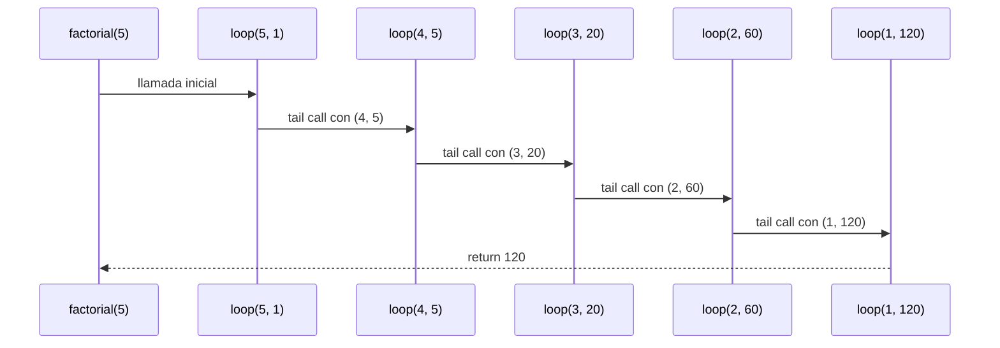
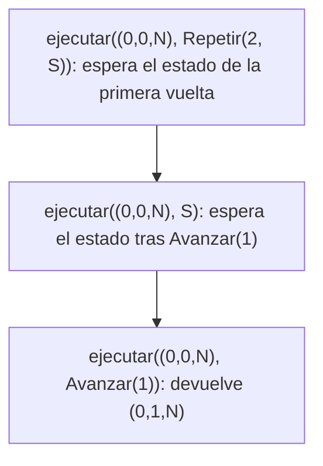
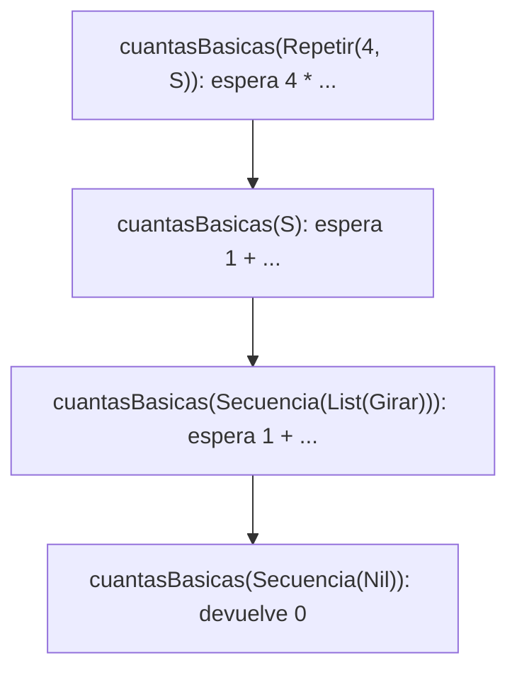
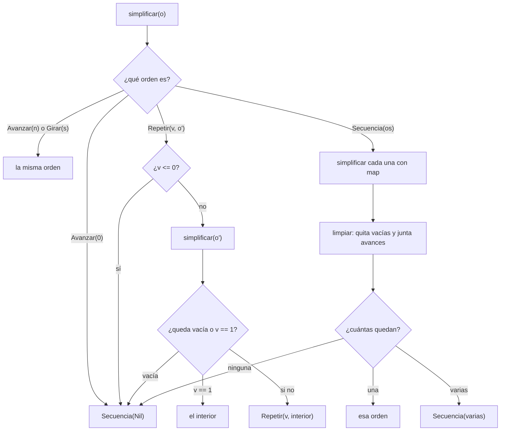

# Algoritmo Factorial con Recursión de Cola

## Definición del Algoritmo

```Scala
def factorial(n: Int): BigInt = {
  @annotation.tailrec
  def loop(x: Int, acumulador: BigInt): BigInt = {
    if (x <= 1) acumulador
    else loop(x - 1, acumulador * x)
  }
  loop(n, 1)
}
```

* La función `factorial` calcula el factorial de un número `n` utilizando **recursión de cola**.
* La función interna `loop` es la que hace la recursión:

  * Recibe dos parámetros:

    * `x`: el valor actual decreciente hasta llegar a 1.
    * `acumulador`: donde se guarda el resultado parcial en cada paso.
* El decorador `@annotation.tailrec` obliga a que la función sea optimizada como recursión de cola, es decir, **no se acumulan llamados en la pila**.

## Explicación paso a paso

### Caso base

```Scala
if (x <= 1) acumulador
```

Cuando `x` llega a `1`, la función retorna directamente el valor acumulado, evitando más llamadas.

### Caso recursivo

```Scala
loop(x - 1, acumulador * x)
```

En cada llamada:

* Se reduce el valor de `x` en 1.
* Se multiplica el acumulador por `x` y se pasa a la siguiente iteración.
* Como es recursión de cola, la llamada recursiva es la **última instrucción** en ejecutarse, lo que permite a Scala optimizar la pila.

---

## Llamados de pila en recursión de cola

Ejemplo:

```Scala
factorial(5)
```

### Paso 1: Llamada inicial

```Scala
loop(5, 1)
```

### Paso 2: Primera iteración

```Scala
loop(4, 5)   // acumulador = 1 * 5
```

### Paso 3: Segunda iteración

```Scala
loop(3, 20)  // acumulador = 5 * 4
```

### Paso 4: Tercera iteración

```Scala
loop(2, 60)  // acumulador = 20 * 3
```

### Paso 5: Cuarta iteración

```Scala
loop(1, 120) // acumulador = 60 * 2
```

### Paso 6: Caso base

```Scala
return 120
```

---

## Diferencia con recursión normal

* En **recursión normal** cada llamada queda en la pila esperando a que termine la siguiente, lo que puede causar desbordamiento si `n` es muy grande.
* En **recursión de cola**, el compilador transforma el proceso en un **bucle optimizado**, por lo que no se guarda cada llamada en la pila y el algoritmo puede ejecutarse para valores muy grandes sin problema.

---

## Ejemplo de uso

```Scala
val resultado = factorial(5)
println(resultado)  // 120
```

El resultado de `factorial(5)` es `120`.


## Diagrama de llamados de pila con recursión de cola




---

# Informe de proceso: puntos 2 y 3

## Punto 2: `ejecutar`

```scala
def ejecutar(e: Estado, o: Orden): Estado = o match {
  case Avanzar(n) => e.mira match {
    case Norte => Estado(e.x, e.y + n, Norte)
    case Este => Estado(e.x + n, e.y, Este)
    case Sur => Estado(e.x, e.y - n, Sur)
    case Oeste => Estado(e.x - n, e.y, Oeste)
  }
  case Girar(s) => Estado(e.x, e.y, girar(e.mira, s))
  case Repetir(veces, orden) =>
    if (veces <= 0) e
    else ejecutar(ejecutar(e, orden), Repetir(veces - 1, orden))
  case Secuencia(Nil) => e
  case Secuencia(primera :: resto) => ejecutar(ejecutar(e, primera), Secuencia(resto))
}
```

### Traza de `ejecutar(inicial, Repetir(2, S))`

Sea `S = Secuencia(List(Avanzar(1), Girar(Derecha)))` e `inicial = Estado(0, 0, Norte)`.

```
ejecutar((0,0,N), Repetir(2, S))
= ejecutar( ejecutar((0,0,N), S), Repetir(1, S) )
    ejecutar((0,0,N), S)
    = ejecutar( ejecutar((0,0,N), Avanzar(1)), Secuencia(List(Girar(Derecha))) )
    = ejecutar( (0,1,N), Secuencia(List(Girar(Derecha))) )
    = ejecutar( ejecutar((0,1,N), Girar(Derecha)), Secuencia(Nil) )
    = ejecutar( (0,1,E), Secuencia(Nil) )
    = (0,1,E)
= ejecutar( (0,1,E), Repetir(1, S) )
= ejecutar( ejecutar((0,1,E), S), Repetir(0, S) )
    ejecutar((0,1,E), S) = (1,1,S)      // avanza al este y gira a la derecha
= ejecutar( (1,1,S), Repetir(0, S) )
= (1,1,S)
```

El resultado es `Estado(1, 1, Sur)`.

### Pila de llamados

Cada llamado de `ejecutar` recibe como argumento el resultado de otro llamado. Ese
argumento se calcula primero y termina antes de que siga el llamado de afuera. Esta
es la pila en el momento más hondo de la traza, cuando se evalúa `Avanzar(1)` dentro
de la primera vuelta:



Cuando `C` devuelve, `B` sigue con el resto de la secuencia, y cuando `B` devuelve, `A`
continúa con `Repetir(1, S)`. La pila nunca es más honda que la estructura de la orden:
cada `Repetir` y cada `Secuencia` abren un nivel, y las repeticiones se van gastando una
a una porque `veces` baja de a uno.

## Punto 3: `cuantasBasicas` y `profundidad`

```scala
def cuantasBasicas(o: Orden): Int = o match {
  case Avanzar(_) => 1
  case Girar(_) => 1
  case Repetir(veces, orden) => if (veces <= 0) 0 else veces * cuantasBasicas(orden)
  case Secuencia(Nil) => 0
  case Secuencia(primera :: resto) => cuantasBasicas(primera) + cuantasBasicas(Secuencia(resto))
}
```

### Traza de `cuantasBasicas(cuadrado)`

Con `cuadrado = Repetir(4, Secuencia(List(Avanzar(1), Girar(Derecha))))`:

```
cuantasBasicas(Repetir(4, Secuencia(List(Avanzar(1), Girar(Derecha)))))
= 4 * cuantasBasicas(Secuencia(List(Avanzar(1), Girar(Derecha))))
= 4 * ( cuantasBasicas(Avanzar(1)) + cuantasBasicas(Secuencia(List(Girar(Derecha)))) )
= 4 * ( 1 + ( cuantasBasicas(Girar(Derecha)) + cuantasBasicas(Secuencia(Nil)) ) )
= 4 * ( 1 + ( 1 + 0 ) )
= 4 * 2
= 8
```



Aquí cada llamado deja una operación pendiente (la multiplicación o la suma), así que
la pila crece con la profundidad de la orden y con la longitud de las secuencias, igual
que `cesar` en el taller 1.

```scala
def profundidad(o: Orden): Int = {
  def masHonda(ordenes: List[Orden]): Int = ordenes match {
    case Nil => 0
    case primera :: resto => math.max(profundidad(primera), masHonda(resto))
  }

  o match {
    case Avanzar(_) => 1
    case Girar(_) => 1
    case Repetir(_, orden) => 1 + profundidad(orden)
    case Secuencia(ordenes) => 1 + masHonda(ordenes)
  }
}
```

### Traza de `profundidad(cuadrado)`

```
profundidad(Repetir(4, Secuencia(List(Avanzar(1), Girar(Derecha)))))
= 1 + profundidad(Secuencia(List(Avanzar(1), Girar(Derecha))))
= 1 + ( 1 + masHonda(List(Avanzar(1), Girar(Derecha))) )
= 1 + ( 1 + max( profundidad(Avanzar(1)), masHonda(List(Girar(Derecha))) ) )
= 1 + ( 1 + max( 1, max( profundidad(Girar(Derecha)), masHonda(Nil) ) ) )
= 1 + ( 1 + max( 1, max( 1, 0 ) ) )
= 1 + ( 1 + 1 )
= 3
```

La función auxiliar `masHonda` recorre la lista de órdenes de una secuencia y se queda
con la profundidad mayor. Para la lista vacía devuelve 0, por eso `Secuencia(Nil)` tiene
profundidad 1. En `Repetir` no se multiplica por `veces`: la profundidad mide cuántos
niveles de anidamiento hay y no cuántas veces se repite.


# Informe de proceso: puntos 1 y 4

## Punto 1: girar

### Funcionamiento

La función girar recibe una dirección y un sentido de giro. Mediante un match, contempla las ocho combinaciones posibles entre las cuatro direcciones (Norte, Este, Sur y Oeste) y los dos sentidos (Derecha e Izquierda). En cada caso devuelve la dirección que resulta de girar noventa grados, sin modificar la posición del robot.

### Traza de cuatro giros a la izquierda

Esta traza corresponde a la prueba propia que comprueba que cuatro giros a la izquierda devuelven la dirección inicial:

girar(Norte, Izquierda) = Oeste
girar(Oeste, Izquierda) = Sur
girar(Sur, Izquierda)   = Este
girar(Este, Izquierda)  = Norte

Después de los cuatro giros, la dirección vuelve a ser Norte. No hay llamadas recursivas en esta función: cada combinación se resuelve directamente mediante uno de los casos del match.

## Punto 4: componer, rutina, aplicarA y transformar

### componer

La función construye una Secuencia con las dos órdenes recibidas, manteniendo su orden original: primero se coloca o1 y después o2.

#### Traza de la prueba propia

componer(Girar(Izquierda), Avanzar(3))
= Secuencia(List(Girar(Izquierda), Avanzar(3)))

La traza muestra que la orden de giro queda antes que la orden de avance, tal como se indicó en la llamada.

### rutina

La función construye una orden Repetir que contiene una secuencia formada por un avance y un giro. Los parámetros indican cuántos pasos avanzar, en qué sentido girar y cuántas veces repetir la secuencia.

#### Traza de la prueba propia

rutina(3)(Derecha)(0)
= Repetir(0, Secuencia(List(Avanzar(3), Girar(Derecha))))
La rutina construida tiene cero repeticiones. Por eso, al ejecutarla, el robot permanece en su estado inicial:
ejecutar(inicial, rutina(3)(Derecha)(0))
= inicial

La función construye la orden; el movimiento se produce cuando esa orden se entrega a ejecutar.

### aplicarA

La función recorre recursivamente una lista de estados. En cada llamada, ejecuta la misma orden sobre el primer estado y añade el resultado a la lista que devuelve la llamada recursiva sobre el resto. Cuando la lista está vacía (Nil), devuelve Nil, que constituye el caso base.

#### Traza con los estados de la prueba propia

aplicarA(
  List(Estado(1, 2, Norte), Estado(4, 5, Este)),
  Avanzar(2)
)
= Estado(1, 4, Norte) ::
    aplicarA(List(Estado(4, 5, Este)), Avanzar(2))
= Estado(1, 4, Norte) ::
    (Estado(6, 5, Este) :: aplicarA(Nil, Avanzar(2)))
= Estado(1, 4, Norte) ::
    (Estado(6, 5, Este) :: Nil)
= List(Estado(1, 4, Norte), Estado(6, 5, Este))

Cada estado se procesa una vez y se conserva el orden de la lista original. La recursión termina al llegar a Nil; entonces las llamadas pendientes construyen la lista de resultados con ::.

### transformar

La función aplica una transformación a las órdenes básicas (Avanzar y Girar) y conserva la estructura de las órdenes compuestas. En una orden Repetir, transforma recursivamente la orden contenida y conserva el número de repeticiones. En una Secuencia, transforma cada elemento de la lista y mantiene su orden.

#### Traza de la prueba propia

La prueba define una función que cambia los giros a la derecha por giros a la izquierda y deja las demás órdenes sin cambios. Con cuadrado = Repetir(4, Secuencia(List(Avanzar(1), Girar(Derecha)))), la transformación produce:

transformar(Repetir(4, Secuencia(List(Avanzar(1), Girar(Derecha)))), f)
= Repetir(4, transformar(Secuencia(List(Avanzar(1), Girar(Derecha))), f))
= Repetir(4, Secuencia(List(
    transformar(Avanzar(1), f),
    transformar(Girar(Derecha), f)
  )))
= Repetir(4, Secuencia(List(Avanzar(1), Girar(Izquierda))))

El avance permanece igual y el giro cambia de Derecha a Izquierda, como espera la prueba.

#### Traza de una secuencia vacía

La otra prueba propia comprueba que transformar una secuencia vacía con la función identidad la deja igual:
transformar(Secuencia(Nil), identidad)
= Secuencia(Nil)
## Resumen del proceso
- girar resuelve cada combinación de dirección y sentido mediante un match.
- componer agrupa dos órdenes en una secuencia, conservando su orden.
- rutina construye una orden repetida que contiene un avance y un giro.
- aplicarA recorre recursivamente una lista de estados y ejecuta una orden sobre cada uno.
- transformar recorre las órdenes compuestas, transforma las órdenes básicas y reconstruye la estructura original.


# Informe de proceso: punto 5

## Punto 5: `simplificar`

```scala
def simplificar(o: Orden): Orden = {
  def limpiar(ordenes: List[Orden]): List[Orden] = ordenes match {
    case Nil => Nil
    case primera :: resto => (primera, limpiar(resto)) match {
      case (Secuencia(Nil), limpias) => limpias
      case (Avanzar(0), limpias) => limpias
      case (Avanzar(a), Avanzar(b) :: cola) =>
        if (a + b == 0) cola
        else Avanzar(a + b) :: cola
      case (otra, limpias) => otra :: limpias
    }
  }

  o match {
    case Avanzar(0) => Secuencia(Nil)
    case Avanzar(_) => o
    case Girar(_) => o
    case Repetir(veces, orden) =>
      if (veces <= 0) Secuencia(Nil)
      else simplificar(orden) match {
        case Secuencia(Nil) => Secuencia(Nil)
        case interior =>
          if (veces == 1) interior
          else Repetir(veces, interior)
      }
    case Secuencia(ordenes) =>
      limpiar(ordenes.map(orden => simplificar(orden))) match {
        case Nil => Secuencia(Nil)
        case unica :: Nil => unica
        case varias => Secuencia(varias)
      }
  }
}
```

### Cómo funciona

`simplificar` recorre la orden con un caso por cada alternativa de `Orden`, igual que las
otras funciones. La diferencia es el orden: **primero se simplifica lo de adentro y después
se aplican las reglas a lo de afuera**. Así, cuando una regla mira una orden, sus partes ya
están reducidas, y una reducción de adentro puede habilitar otra de afuera sin tener que
recorrer la orden de nuevo. Eso cumple lo de "tantas veces como haga falta".

| Caso | Qué hace | Regla |
|---|---|---|
| `Avanzar(0)` | devuelve `Secuencia(Nil)` | 1 |
| `Avanzar(n)`, `Girar(s)` | quedan igual | |
| `Repetir(v, o')` con `v <= 0` | devuelve `Secuencia(Nil)` | 1 |
| `Repetir(v, o')` con `o'` vacía | devuelve `Secuencia(Nil)`: repetir nada es nada | 5 |
| `Repetir(1, o')` | devuelve `o'` ya simplificada | 3 |
| `Repetir(v, o')` con `v >= 2` | `Repetir(v, simplificar(o'))` | |
| `Secuencia(os)` | simplifica cada una, la pasa por `limpiar` y mira cuántas quedan | 2, 4, 5 |

`limpiar` es la función auxiliar que vive dentro de `simplificar`. Recorre la lista de
derecha a izquierda: primero limpia el resto y luego decide qué hacer con la primera orden.

- Si la primera es `Secuencia(Nil)` o `Avanzar(0)`, no hace nada y se descarta (regla 5).
- Si es un `Avanzar(a)` y lo que sigue empieza por `Avanzar(b)`, los junta en `Avanzar(a + b)`
  (regla 2). Si la suma es 0, los dos desaparecen.
- En cualquier otro caso, la deja donde está.

Después de `limpiar`, la secuencia queda vacía (`Secuencia(Nil)`), con un solo elemento
(se devuelve ese elemento, regla 4) o con varios (`Secuencia(varias)`).

### Traza 1: una reducción de adentro habilita otra de afuera

Sea `S2 = Secuencia(List(Avanzar(0), Avanzar(4)))` y

`O = Secuencia(List(Avanzar(1), Repetir(1, S2), Girar(Derecha)))`.

```
simplificar(O)
= limpiar( List(simplificar(Avanzar(1)), simplificar(Repetir(1, S2)), simplificar(Girar(Derecha))) ) y se mira el resultado

  simplificar(Avanzar(1)) = Avanzar(1)

  simplificar(Repetir(1, S2))
  = simplificar(S2) y se mira el resultado
      simplificar(S2) = limpiar( List(simplificar(Avanzar(0)), simplificar(Avanzar(4))) )
                      = limpiar( List(Secuencia(Nil), Avanzar(4)) )
                        limpiar(List(Avanzar(4))) = List(Avanzar(4))
                        (Secuencia(Nil), List(Avanzar(4))) => List(Avanzar(4))   // la vacía se descarta
                      = List(Avanzar(4)), que queda como Avanzar(4)   // un solo elemento
  = Avanzar(4)   // veces == 1: se devuelve el interior

  simplificar(Girar(Derecha)) = Girar(Derecha)

= limpiar( List(Avanzar(1), Avanzar(4), Girar(Derecha)) )
    limpiar(List(Girar(Derecha)))                     = List(Girar(Derecha))
    (Avanzar(4), List(Girar(Derecha)))                => List(Avanzar(4), Girar(Derecha))
    (Avanzar(1), Avanzar(4) :: List(Girar(Derecha)))  => Avanzar(5) :: List(Girar(Derecha))   // 1 + 4
= List(Avanzar(5), Girar(Derecha)), que queda como Secuencia(List(Avanzar(5), Girar(Derecha)))
```

El `Repetir(1, ...)` y el `Avanzar(0)` de adentro desaparecieron primero, y por eso el
`Avanzar(1)` y el `Avanzar(4)` quedaron uno al lado del otro y se pudieron juntar. Con una
sola pasada de las reglas sobre la orden original eso no habría pasado.

**Posiciones del robot.** La orden original y la simplificada dejan al robot en el mismo lugar:

| Orden original `O` | Estado | | Orden simplificada | Estado |
|---|---|---|---|---|
| (inicio) | `(0, 0, N)` | | (inicio) | `(0, 0, N)` |
| `Avanzar(1)` | `(0, 1, N)` | | `Avanzar(5)` | `(0, 5, N)` |
| `Avanzar(0)` | `(0, 1, N)` | | | |
| `Avanzar(4)` | `(0, 5, N)` | | | |
| `Girar(Derecha)` | `(0, 5, E)` | | `Girar(Derecha)` | `(0, 5, E)` |

### Traza 2: dos avances que se cancelan

Con `O = Secuencia(List(Avanzar(2), Avanzar(-2)))`:

```
simplificar(O)
= limpiar( List(Avanzar(2), Avanzar(-2)) ) y se mira el resultado
    limpiar(List(Avanzar(-2))) = List(Avanzar(-2))
    (Avanzar(2), Avanzar(-2) :: Nil) => 2 + (-2) == 0, así que devuelve la cola: Nil
= Nil, que queda como Secuencia(Nil)
```

Posiciones: la orden original lleva el robot de `(0, 0, N)` a `(0, 2, N)` y de ahí de vuelta a
`(0, 0, N)`. La simplificada, `Secuencia(Nil)`, lo deja en `(0, 0, N)`. Es el mismo estado.

### Cómo se recorre la orden



Cada llamado recursivo se hace sobre una parte propia de la orden y `limpiar` recorre una
lista que se acorta en cada llamado, así que el cálculo termina.

## Resumen del proceso
- girar resuelve cada combinación de dirección y sentido mediante un match.
- ejecutar recorre la orden con un caso por alternativa; la traza del cuadrado muestra el estado del robot en cada paso.
- cuantasBasicas y profundidad miden la orden sin ejecutarla.
- componer agrupa dos órdenes en una secuencia, conservando su orden.
- rutina construye una orden repetida que contiene un avance y un giro.
- aplicarA recorre recursivamente una lista de estados y ejecuta una orden sobre cada uno.
- transformar recorre las órdenes compuestas, transforma las órdenes básicas y reconstruye la estructura original.
 No newline at end of file
- transformar recorre las órdenes compuestas, transforma las órdenes básicas y reconstruye la estructura original.
- simplificar reduce primero lo de adentro y después aplica las reglas a lo de afuera; con eso una sola recursión basta y el estado final del robot no cambia.