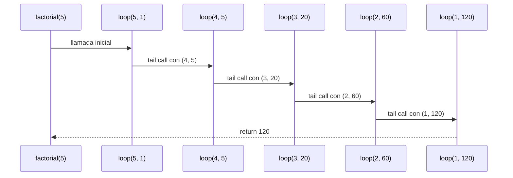
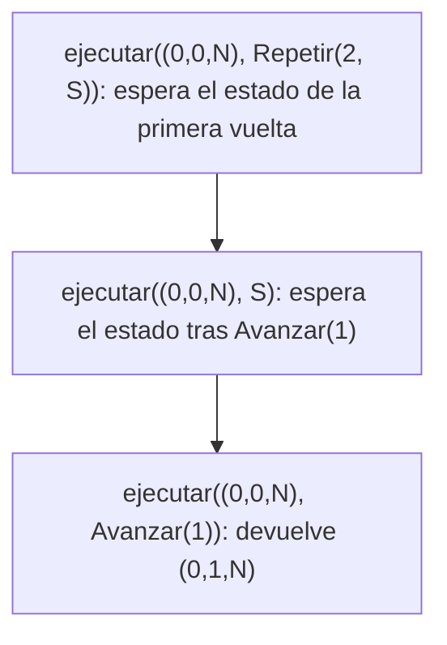
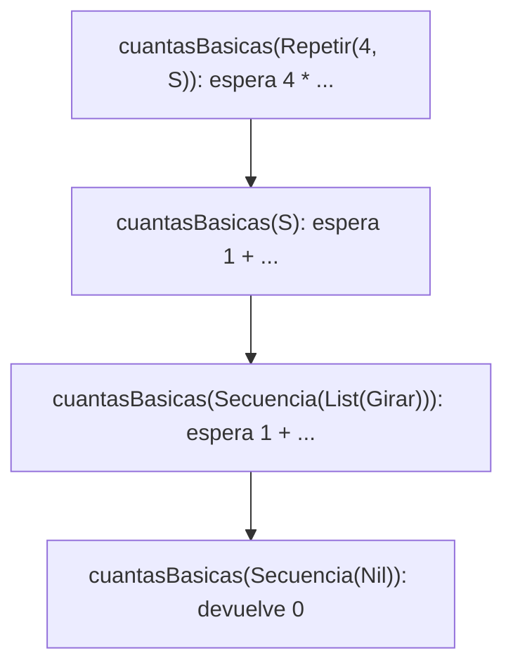

# Algoritmo Factorial con Recursión de Cola

## Definición del Algoritmo

```Scala
def factorial(n: Int): BigInt = {
  @annotation.tailrec
  def loop(x: Int, acumulador: BigInt): BigInt = {
    if (x <= 1) acumulador
    else loop(x - 1, acumulador * x)
  }
  loop(n, 1)
}
```

* La función `factorial` calcula el factorial de un número `n` utilizando **recursión de cola**.
* La función interna `loop` es la que hace la recursión:

  * Recibe dos parámetros:

    * `x`: el valor actual decreciente hasta llegar a 1.
    * `acumulador`: donde se guarda el resultado parcial en cada paso.
* El decorador `@annotation.tailrec` obliga a que la función sea optimizada como recursión de cola, es decir, **no se acumulan llamados en la pila**.

## Explicación paso a paso

### Caso base

```Scala
if (x <= 1) acumulador
```

Cuando `x` llega a `1`, la función retorna directamente el valor acumulado, evitando más llamadas.

### Caso recursivo

```Scala
loop(x - 1, acumulador * x)
```

En cada llamada:

* Se reduce el valor de `x` en 1.
* Se multiplica el acumulador por `x` y se pasa a la siguiente iteración.
* Como es recursión de cola, la llamada recursiva es la **última instrucción** en ejecutarse, lo que permite a Scala optimizar la pila.

---

## Llamados de pila en recursión de cola

Ejemplo:

```Scala
factorial(5)
```

### Paso 1: Llamada inicial

```Scala
loop(5, 1)
```

### Paso 2: Primera iteración

```Scala
loop(4, 5)   // acumulador = 1 * 5
```

### Paso 3: Segunda iteración

```Scala
loop(3, 20)  // acumulador = 5 * 4
```

### Paso 4: Tercera iteración

```Scala
loop(2, 60)  // acumulador = 20 * 3
```

### Paso 5: Cuarta iteración

```Scala
loop(1, 120) // acumulador = 60 * 2
```

### Paso 6: Caso base

```Scala
return 120
```

---

## Diferencia con recursión normal

* En **recursión normal** cada llamada queda en la pila esperando a que termine la siguiente, lo que puede causar desbordamiento si `n` es muy grande.
* En **recursión de cola**, el compilador transforma el proceso en un **bucle optimizado**, por lo que no se guarda cada llamada en la pila y el algoritmo puede ejecutarse para valores muy grandes sin problema.

---

## Ejemplo de uso

```Scala
val resultado = factorial(5)
println(resultado)  // 120
```

El resultado de `factorial(5)` es `120`.


## Diagrama de llamados de pila con recursión de cola




---

# Informe de proceso: puntos 2 y 3

## Punto 2: `ejecutar`

```scala
def ejecutar(e: Estado, o: Orden): Estado = o match {
  case Avanzar(n) => e.mira match {
    case Norte => Estado(e.x, e.y + n, Norte)
    case Este => Estado(e.x + n, e.y, Este)
    case Sur => Estado(e.x, e.y - n, Sur)
    case Oeste => Estado(e.x - n, e.y, Oeste)
  }
  case Girar(s) => Estado(e.x, e.y, girar(e.mira, s))
  case Repetir(veces, orden) =>
    if (veces <= 0) e
    else ejecutar(ejecutar(e, orden), Repetir(veces - 1, orden))
  case Secuencia(Nil) => e
  case Secuencia(primera :: resto) => ejecutar(ejecutar(e, primera), Secuencia(resto))
}
```

### Traza de `ejecutar(inicial, Repetir(2, S))`

Sea `S = Secuencia(List(Avanzar(1), Girar(Derecha)))` e `inicial = Estado(0, 0, Norte)`.

```
ejecutar((0,0,N), Repetir(2, S))
= ejecutar( ejecutar((0,0,N), S), Repetir(1, S) )
    ejecutar((0,0,N), S)
    = ejecutar( ejecutar((0,0,N), Avanzar(1)), Secuencia(List(Girar(Derecha))) )
    = ejecutar( (0,1,N), Secuencia(List(Girar(Derecha))) )
    = ejecutar( ejecutar((0,1,N), Girar(Derecha)), Secuencia(Nil) )
    = ejecutar( (0,1,E), Secuencia(Nil) )
    = (0,1,E)
= ejecutar( (0,1,E), Repetir(1, S) )
= ejecutar( ejecutar((0,1,E), S), Repetir(0, S) )
    ejecutar((0,1,E), S) = (1,1,S)      // avanza al este y gira a la derecha
= ejecutar( (1,1,S), Repetir(0, S) )
= (1,1,S)
```

El resultado es `Estado(1, 1, Sur)`.

### Pila de llamados

Cada llamado de `ejecutar` recibe como argumento el resultado de otro llamado. Ese
argumento se calcula primero y termina antes de que siga el llamado de afuera. Esta
es la pila en el momento más hondo de la traza, cuando se evalúa `Avanzar(1)` dentro
de la primera vuelta:



Cuando `C` devuelve, `B` sigue con el resto de la secuencia, y cuando `B` devuelve, `A`
continúa con `Repetir(1, S)`. La pila nunca es más honda que la estructura de la orden:
cada `Repetir` y cada `Secuencia` abren un nivel, y las repeticiones se van gastando una
a una porque `veces` baja de a uno.

## Punto 3: `cuantasBasicas` y `profundidad`

```scala
def cuantasBasicas(o: Orden): Int = o match {
  case Avanzar(_) => 1
  case Girar(_) => 1
  case Repetir(veces, orden) => if (veces <= 0) 0 else veces * cuantasBasicas(orden)
  case Secuencia(Nil) => 0
  case Secuencia(primera :: resto) => cuantasBasicas(primera) + cuantasBasicas(Secuencia(resto))
}
```

### Traza de `cuantasBasicas(cuadrado)`

Con `cuadrado = Repetir(4, Secuencia(List(Avanzar(1), Girar(Derecha))))`:

```
cuantasBasicas(Repetir(4, Secuencia(List(Avanzar(1), Girar(Derecha)))))
= 4 * cuantasBasicas(Secuencia(List(Avanzar(1), Girar(Derecha))))
= 4 * ( cuantasBasicas(Avanzar(1)) + cuantasBasicas(Secuencia(List(Girar(Derecha)))) )
= 4 * ( 1 + ( cuantasBasicas(Girar(Derecha)) + cuantasBasicas(Secuencia(Nil)) ) )
= 4 * ( 1 + ( 1 + 0 ) )
= 4 * 2
= 8
```



Aquí cada llamado deja una operación pendiente (la multiplicación o la suma), así que
la pila crece con la profundidad de la orden y con la longitud de las secuencias, igual
que `cesar` en el taller 1.

```scala
def profundidad(o: Orden): Int = {
  def masHonda(ordenes: List[Orden]): Int = ordenes match {
    case Nil => 0
    case primera :: resto => math.max(profundidad(primera), masHonda(resto))
  }

  o match {
    case Avanzar(_) => 1
    case Girar(_) => 1
    case Repetir(_, orden) => 1 + profundidad(orden)
    case Secuencia(ordenes) => 1 + masHonda(ordenes)
  }
}
```

### Traza de `profundidad(cuadrado)`

```
profundidad(Repetir(4, Secuencia(List(Avanzar(1), Girar(Derecha)))))
= 1 + profundidad(Secuencia(List(Avanzar(1), Girar(Derecha))))
= 1 + ( 1 + masHonda(List(Avanzar(1), Girar(Derecha))) )
= 1 + ( 1 + max( profundidad(Avanzar(1)), masHonda(List(Girar(Derecha))) ) )
= 1 + ( 1 + max( 1, max( profundidad(Girar(Derecha)), masHonda(Nil) ) ) )
= 1 + ( 1 + max( 1, max( 1, 0 ) ) )
= 1 + ( 1 + 1 )
= 3
```

La función auxiliar `masHonda` recorre la lista de órdenes de una secuencia y se queda
con la profundidad mayor. Para la lista vacía devuelve 0, por eso `Secuencia(Nil)` tiene
profundidad 1. En `Repetir` no se multiplica por `veces`: la profundidad mide cuántos
niveles de anidamiento hay y no cuántas veces se repite.
